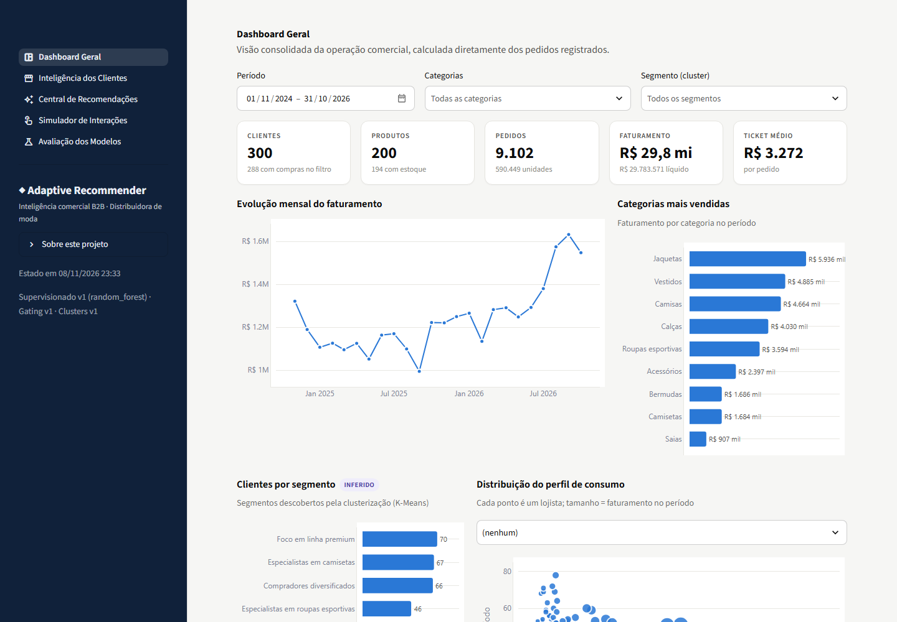
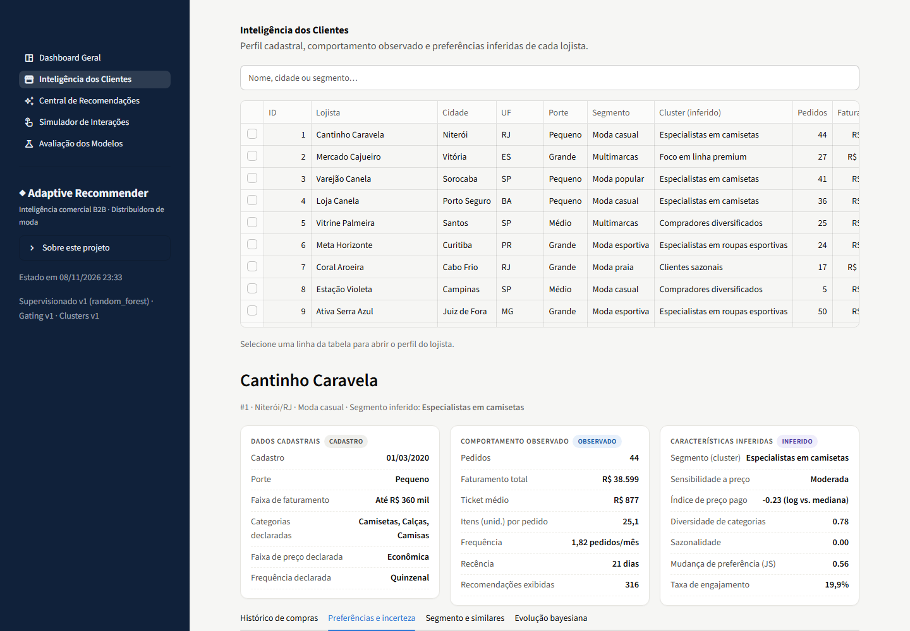
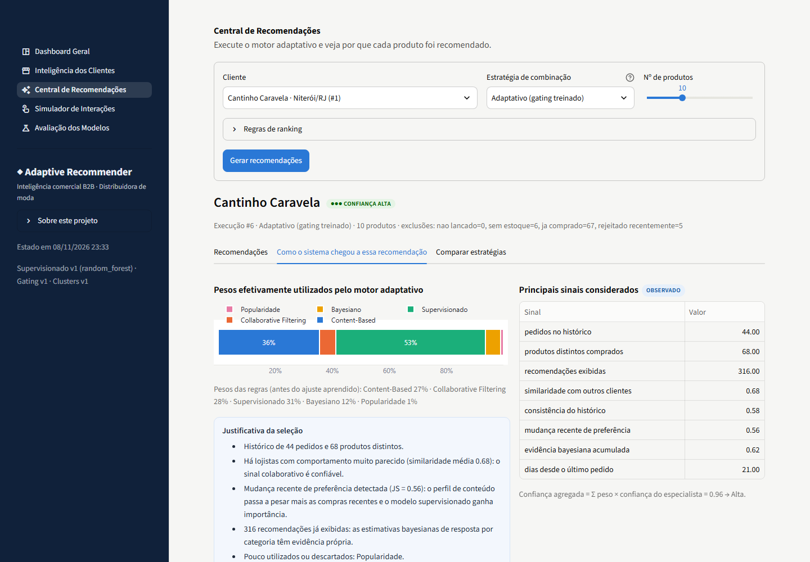
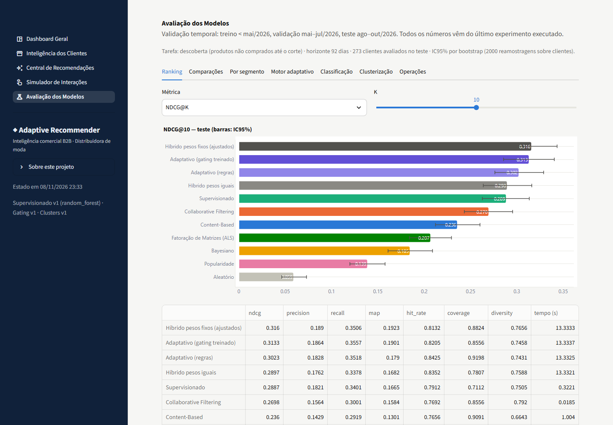

# Adaptive Recommender — a weekend playground for recommender systems

🇧🇷 [Leia em português](README.pt-BR.md)

> **About this project.** I built this over a weekend, just because I wanted to get my hands dirty with
> recommender systems: try several models side by side, play with a "mixture of experts" that picks
> different models for different customers, and learn things I didn't know yet (Beta-Binomial updating,
> implicit ALS, listwise gating, temporal evaluation…).
> It was built for **fun and learning**, not for production. Some parts are deliberately more complex than
> the problem needs — that was the point: exploring.



## What it does

A recommender for a fictional clothing **wholesaler** that sells to ~300 retail stores (B2B). For each store
it suggests products **the store has not bought yet** and is likely to buy in the next ~3 months.

Five "expert" models each look at the problem differently:

| Expert | Idea |
|---|---|
| Content-based | products similar to what the store already buys (TF-IDF + attribute vectors) |
| Collaborative filtering | what similar stores bought (user-kNN; implicit ALS as a comparison) |
| Supervised | calibrated purchase probability (Logistic Regression / Random Forest / LightGBM) |
| Bayesian | how the store reacts to recommendations of each category (two-stage Beta-Binomial with empirical-Bayes priors) |
| Popularity | what is selling well — the fallback for brand-new stores |

An **adaptive engine** decides how much each expert counts *for each store* (rules + a trainable
residual gating), explains every recommendation, and **learns from feedback** (click / like / cart /
purchase / reject) with incremental Bayesian updates.

Everything is wrapped in a 5-page Streamlit app: sales dashboard, customer intelligence, recommendation
center ("why was this recommended?"), interaction simulator, and a model-evaluation lab.

| | |
|---|---|
|  |  |
|  | |

## What I found (honest version)

Evaluation is temporal (train < May/2026, validate May–Jul, test Aug–Oct), on the *discovery* task, with
bootstrap 95% CIs over customers.

**Synthetic data (300 stores, 273 evaluated, NDCG@10):**

| Strategy | NDCG@10 |
|---|---|
| Hybrid, fixed weights tuned on validation | **0.316** [0.287, 0.343] |
| Adaptive (trained gating) | **0.313** [0.286, 0.340] |
| Adaptive (rules only) | 0.302 |
| Supervised alone | 0.289 |
| Collaborative (kNN) | 0.270 |
| Content-based | 0.236 |
| Popularity | 0.139 |
| Random | 0.059 |

- Combining experts clearly helps: adaptive − best single expert = +0.025 (CI above zero).
- **The adaptive engine ties a simple tuned fixed-weight blend** (Δ = −0.003, CI [−0.019, +0.014]). It is
  *not* better — so it is not claimed to be.
- With only 50 stores the trainable gating couldn't learn anything and an apparent advantage on "customers
  who changed taste" showed up (n = 7). With 300 stores that advantage vanished: it was sampling noise.
  Probably the most useful lesson of the weekend.

**Real data — [Online Retail II](https://archive.ics.uci.edu/dataset/502/online+retail+ii) (UCI, CC BY 4.0).**
To check the synthetic results aren't an artefact of my own generator, the *same pipeline* runs on real
transactions from a UK online wholesaler (500 sampled customers, top-400 products, 2009–2011):

| Strategy | NDCG@10 |
|---|---|
| Hybrid, tuned fixed weights | 0.094 [0.076, 0.112] |
| Supervised | 0.091 |
| Collaborative (kNN) | 0.085 |
| Adaptive (trained gating) | 0.084 |
| Popularity | 0.070 |
| Random | 0.034 |

Real data is much sparser (median of 3 orders per customer) so all numbers drop, the top strategies are
statistically tied, content-based suffers from short product descriptions, and the Bayesian expert is
useless because the dataset has no recommendation logs. Same qualitative story, no magic.
Full reports: [synthetic](docs/MODEL_EVALUATION.md) · [real data](docs/REAL_DATA_EVALUATION.md).

## Run it

Windows: double-click **`run.bat`**. macOS / Linux: `./run.sh`.
The first run creates a virtualenv, installs dependencies, generates the data, trains the models and runs the
evaluation (~6–8 min). Then the app opens at `http://localhost:8501`.

```bash
python scripts/generate_data.py            # synthetic data (--customers N to change the size)
python scripts/initialize_database.py      # SQLite schema + load (--reset to rebuild)
python scripts/train_models.py             # controlled retraining, versioned models
python scripts/run_evaluation.py           # temporal experiment → docs/MODEL_EVALUATION.md
python scripts/download_real_data.py       # optional: Online Retail II (~45 MB)
python scripts/run_real_data_experiment.py # optional: same experiment on real data
python -m pytest                           # test suite
```

Python 3.12 · pandas · NumPy · SciPy · scikit-learn · LightGBM · SQLAlchemy/SQLite · Plotly · Streamlit · pytest.
Runs fully offline; no LLM is used for recommending.

## Repository map

```
app/            Streamlit UI (views + components) — presentation only
src/
  data_generation/  synthetic stores, catalog and a chronological order/interaction simulator
  data_sources/     adapter for the real Online Retail II dataset
  preprocessing/    point-in-time snapshots (no future leakage) and feature engineering
  segmentation/     K-Means / Ward clustering with stability-based k selection
  recommenders/     the experts, all behind one interface (fit / score / confidence / explain)
  adaptive/         evidence signals, rule gating, trainable gating, mixture of experts
  ranking/          eligibility rules, fatigue, margin as a separate objective, MMR diversification
  learning/         feedback, incremental Bayesian updates, controlled retraining
  evaluation/       metrics, temporal protocol, bootstrap comparisons, report generation
  services/         facades used by the UI
database/       schema.sql + repositories (SQLite, PostgreSQL-ready)
config/         settings + domain profiles (synthetic / online_retail)
docs/           architecture, methodology, math foundations, data dictionary, evaluations, user guide
tests/          pytest suite (unit, integration, end-to-end)
```

Docs (in Portuguese): [architecture](docs/ARCHITECTURE.md) · [methodology](docs/METHODOLOGY.md) ·
[mathematical foundations](docs/MATHEMATICAL_FOUNDATIONS.md) · [data dictionary](docs/DATA_DICTIONARY.md) ·
[user guide](docs/USER_GUIDE.md).

## Limitations

- The main app uses **synthetic** data; the generator defines the ground truth, so results there say more
  about the architecture than about real customers (hence the real-data check).
- Some models are over-engineered for a ~300-customer problem — on purpose, it's a playground.
- Small-segment results (cold start, n ≈ 18) are indicative, not conclusive.

## License

MIT for the code. The optional real-data experiment downloads *Online Retail II* (Chen, D., UCI Machine
Learning Repository, CC BY 4.0) at runtime; the dataset is not redistributed here.
