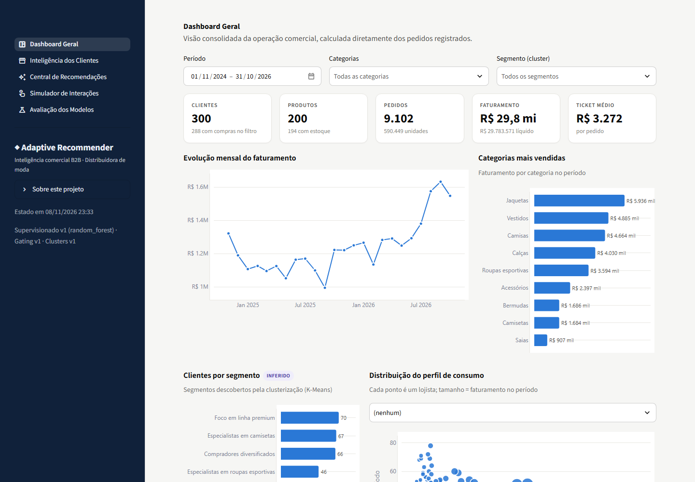
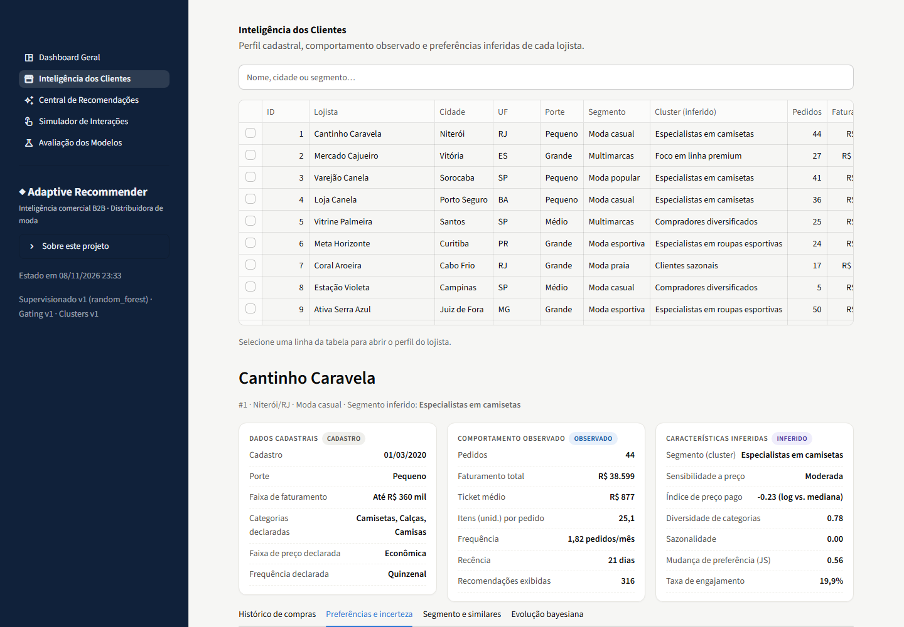
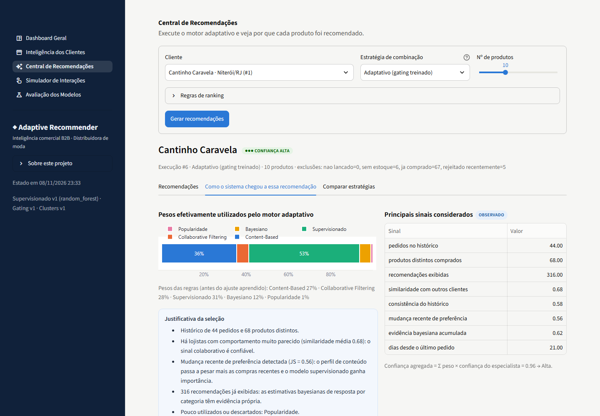
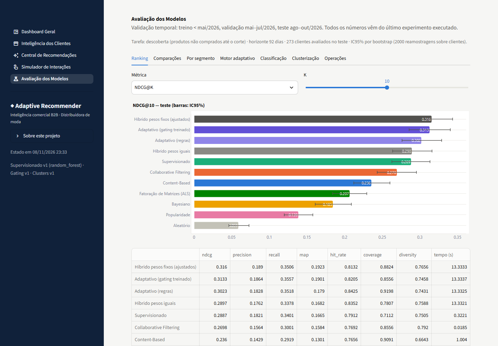

# Adaptive Recommender — um laboratório de fim de semana sobre sistemas de recomendação

🇺🇸 [Read in English](README.md)

> **Sobre este projeto.** Fiz este projeto durante um final de semana, simplesmente porque queria testar
> na prática vários modelos de recomendação: colocá-los lado a lado, brincar com um "mixture of experts"
> que escolhe modelos diferentes para clientes diferentes e aprender coisas que eu ainda não conhecia
> (atualização Beta-Binomial, ALS implícito, gating listwise, avaliação temporal…).
> O foco foi **me divertir e aprender**, não construir algo para produção — por isso alguns modelos são mais
> complexos do que o problema exigiria, de propósito.

## O que ele faz

Um recomendador para uma **distribuidora de roupas** fictícia que vende para ~300 lojas (B2B). Para cada loja,
sugere produtos que ela **ainda não comprou** e que provavelmente compraria nos próximos ~3 meses.

| Especialista | Ideia |
|---|---|
| Content-Based | produtos parecidos com o que a loja já compra (TF-IDF + vetores de atributos) |
| Collaborative Filtering | o que lojas parecidas compraram (user-kNN; ALS implícito como comparação) |
| Supervisionado | probabilidade calibrada de compra (Regressão Logística / Random Forest / LightGBM) |
| Bayesiano | como a loja reage às recomendações de cada categoria (Beta-Binomial em dois estágios, priors por Bayes empírico) |
| Popularidade | o que está vendendo — o recurso para lojas sem histórico |

Um **motor adaptativo** decide o peso de cada especialista *para cada loja* (regras + gating residual
treinável), explica cada recomendação e **aprende com o feedback** (clique, gostei, carrinho, compra,
rejeição) com atualização bayesiana incremental. Tudo numa aplicação Streamlit de 5 páginas.

| | |
|---|---|
|  |  |
|  | |

## O que eu descobri (versão honesta)

Avaliação temporal (treino < mai/2026, validação mai–jul, teste ago–out), tarefa de *descoberta*, IC95% por
bootstrap sobre clientes.

**Dados sintéticos (300 lojas, 273 avaliadas, NDCG@10):** pesos fixos ajustados **0,316** · adaptativo
(gating treinado) **0,313** · adaptativo (regras) 0,302 · supervisionado 0,289 · collaborative 0,270 ·
content-based 0,236 · popularidade 0,139 · aleatório 0,059.

- Combinar especialistas ajuda de verdade: adaptativo − melhor especialista isolado = +0,025 (IC acima de zero).
- **O motor adaptativo empata com uma combinação simples de pesos fixos** (Δ = −0,003, IC [−0,019; +0,014]).
  Não é melhor — e por isso não é declarado melhor.
- Com só 50 lojas o gating treinável não aprendia nada e aparecia uma "vantagem" em clientes que mudaram de
  gosto (n = 7). Com 300 lojas a vantagem sumiu: era ruído amostral. Talvez a lição mais útil do fim de semana.

**Dados reais — [Online Retail II](https://archive.ics.uci.edu/dataset/502/online+retail+ii) (UCI, CC BY 4.0).**
Para verificar que os resultados não são um artefato do meu próprio gerador, o *mesmo pipeline* roda sobre
transações reais de um atacadista online do Reino Unido (500 clientes, 400 produtos, 2009–2011):
pesos fixos 0,094 · supervisionado 0,091 · collaborative 0,085 · adaptativo 0,084 · popularidade 0,070 ·
aleatório 0,034. Dados reais são muito mais esparsos (mediana de 3 pedidos por cliente): os números caem,
as melhores estratégias empatam, o content-based sofre com descrições curtas e o bayesiano fica inútil
(não há logs de recomendação). Mesma história qualitativa, sem mágica.
Relatórios completos: [sintético](docs/MODEL_EVALUATION.md) · [dados reais](docs/REAL_DATA_EVALUATION.md).

## Como executar

Windows: dois cliques em **`run.bat`**. macOS / Linux: `./run.sh`. A primeira execução cria o ambiente,
instala as dependências, gera os dados, treina os modelos e roda a avaliação (~6–8 min); depois o app abre em
`http://localhost:8501`. Comandos individuais e o experimento com dados reais estão no
[README em inglês](README.md#run-it) e no [manual do usuário](docs/USER_GUIDE.md).

## Documentação

[Arquitetura](docs/ARCHITECTURE.md) · [Metodologia](docs/METHODOLOGY.md) ·
[Fundamentos matemáticos](docs/MATHEMATICAL_FOUNDATIONS.md) · [Dicionário de dados](docs/DATA_DICTIONARY.md) ·
[Avaliação sintética](docs/MODEL_EVALUATION.md) · [Avaliação em dados reais](docs/REAL_DATA_EVALUATION.md) ·
[Manual do usuário](docs/USER_GUIDE.md) · [Estado do projeto](PROJECT_STATUS.md)

## Limitações

- O app principal usa dados **sintéticos**: o gerador define a "verdade", então os resultados falam mais da
  arquitetura do que de clientes reais (daí o experimento com dados reais).
- Alguns modelos são complexos demais para um problema de ~300 clientes — de propósito.
- Resultados em segmentos pequenos (cold start, n ≈ 18) são indicativos, não conclusivos.

## Licença

MIT para o código. O experimento opcional baixa o *Online Retail II* (Chen, D., UCI Machine Learning
Repository, CC BY 4.0) em tempo de execução; o dataset não é redistribuído aqui.
